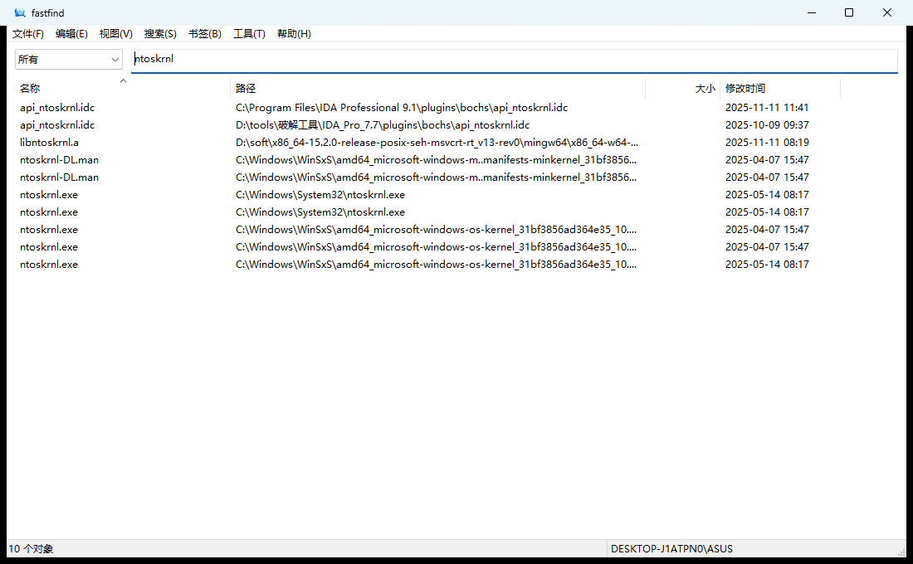

<div align="center">

[English](README.md) | **简体中文**

</div>

# fastfind

免费、开源的 Windows 即时文件名搜索（[MIT 许可证](LICENSE)）。直接读取 NTFS `$MFT` 建内存索引，并用 USN 日志保持更新。

如果这个工具对你有用，请在 GitHub 上点一颗 **Star**。这是对项目最直接的支持。

| 源文件 | 程序 |
|---|---|
| `fastfind.cpp` | `fastfind.exe`（命令行） |
| `fastfindui.cpp` | `fastfindui.exe`（图形界面） |



## 使用

双击 `fastfindui.exe`（读卷需要管理员权限）。首次建索引大约半分钟；之后从缓存加载，并自动回放程序关闭期间发生的变更（缓存记录了每卷的 USN 位置；日志被覆盖或重建时自动全量重扫）。在顶部输入即搜，空格表示同时匹配。新建、改名、删除会在几秒内反映到结果里。双击一条结果，在资源管理器中定位该文件。点窗口关闭时会询问"最小化到系统托盘"还是"退出"，勾选后记住选择；托盘左键恢复，右键出菜单。

右键文件夹可直接在该目录下搜索。托盘菜单里注册或移除，也可以：

```
fastfindui.exe -install-menu
fastfindui.exe -uninstall-menu
fastfindui.exe -p "D:\某目录"
```

## 搜索语法

| 语法 | 含义 |
|---|---|
| `foo bar` | 多个词都要出现在文件名里 |
| `"foo bar"` | 把含空格的一段当成一个词 |
| `path:foo` | 在完整路径里找 |
| `C:\tools\` | 只搜这个目录 |
| `*.cpp` / `ext:txt` | 按扩展名 |
| `file:` / `folder:` | 只要文件或只要文件夹 |
| `!foo` | 排除 |

搜索菜单里还可以开关区分大小写、全字匹配、匹配路径。

## 命令行

```
fastfind --build [--fresh]      建立或重建索引
fastfind <关键词> [关键词...]    搜索一次
fastfind -i [--watch]           交互搜索，--watch 开启实时更新
```

索引缓存在 `%LOCALAPPDATA%\fastfind-index.bin`。没有管理员权限时会退回普通目录遍历，能用，但慢。

## 编译

需要 MinGW-w64。双击 `build.bat`，或在终端运行它。编译前先从托盘退出正在运行的程序。

## 声明

本项目按 [MIT 许可证](LICENSE) 完全免费开源，个人和商业使用都不收费。使用或引用本项目（整体或部分，含代码与文档）时，须声明来源并保留版权与许可声明。软件按原样提供，读取 NTFS 通常需要管理员权限。
